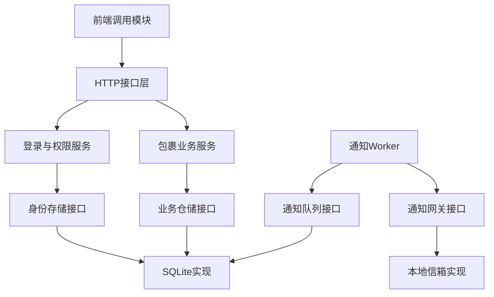
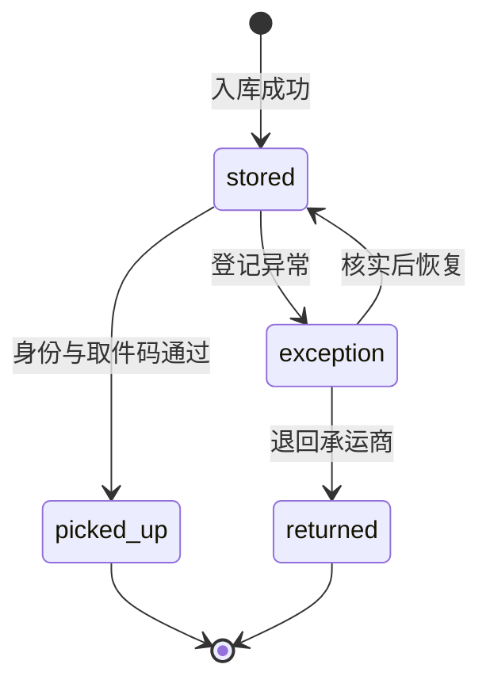

# 核心代码与接口说明

## 1. 本次代码应展示什么

本版本体现从HTTP请求到业务用例、领域规则、数据库事务和通知网关的完整调用关系。主要业务有真实实现；短信与完整界面作为可替换边界处理。运行入口为 `main.py`，所有依赖在 `src/bootstrap.py` 中统一组装。



## 2. 核心契约与依赖方向

`src/application/ports.py` 使用 Protocol 定义 `StationRepository`、`IdentityRepository`、`NotificationQueue`、`NotificationGateway`、`Clock`。应用层调用这些接口，由组装入口注入SQLite及本地网关。可以在不修改业务用例的情况下替换数据库或真实短信适配器。

| 核心类 | 主要方法 | 对应实现 |
|---|---|---|
| StationService | receive、pickup、get、search、exception、resolve、relocate、overdue、statistics、audits、export | 业务校验与权限，委托仓储原子处理 |
| AuthService | login、authenticate、create_user | 验证口令、生成会话、创建操作账号 |
| StationRepository | register、pickup_verified、mark_exception、resolve_exception等 | SQLiteParcelRepository |
| NotificationQueue | claim_notification、finish_notification、notifications | SQLite Outbox表与租约事务 |
| NotificationGateway | send(event_key,payload) | FileNotificationGateway |
| NotificationWorker | dispatch | 领取、调用网关、重试或记录失败 |

## 3. HTTP接口清单

接口统一以 `/api` 开头，除健康检查与登录之外均要求 `Authorization: Bearer <token>`。`recipient` 是演示收件人标识，不代表系统完成了证件识别。实际操作者始终由会话确定，客户端不能通过请求体指定其他操作者。

| 方法 | 路径 | 功能 | 权限 |
|---|---|---|---|
| GET | `/api/health` | 健康检查 | public |
| POST | `/api/auth/login` | 账号登录 | public |
| POST | `/api/users` | 创建操作员 | users |
| POST | `/api/parcels` | 幂等包裹入库 | receive |
| GET | `/api/parcels` | 筛选与分页查询 | read |
| GET | `/api/parcels/{id}` | 包裹详情 | read |
| POST | `/api/parcels/{id}/pickup` | 身份与取件码核验出库 | pickup |
| PATCH | `/api/parcels/{id}/location` | 调整货架位置 | relocate |
| POST | `/api/parcels/{id}/exceptions` | 登记异常件 | exception |
| POST | `/api/exceptions/{id}/resolve` | 恢复在库或退回承运商 | exception |
| POST | `/api/parcels/{id}/reset-pickup` | 管理员解除取件码锁定 | dispatch |
| GET | `/api/parcels/overdue` | 滞留件分页查询 | read |
| GET | `/api/statistics` | 业务状态与滞留统计 | read |
| GET | `/api/audits` | 审计日志分页查询 | audit |
| GET | `/api/parcels/export.csv` | 脱敏CSV导出 | export |
| GET | `/api/notifications` | 通知处理状态查询 | dispatch |
| POST | `/api/notifications/dispatch` | 执行一批本地通知发送 | dispatch |

### 3.1 入库请求示例

```json
{
  "tracking_no": "SF-DEMO-001",
  "recipient": "resident-001",
  "phone": "13800000000",
  "carrier": "测试快递",
  "location": "A-01",
  "request_key": "inbound-001"
}
```

手机号支持6—20位ASCII数字用于演示；运单按输入的完整规范化字符串判定唯一，不自动移除运单内部符号。所有必填字符串拒绝空白和首尾空格。`request_key` 由调用方生成，网络重试时保留原键及参数。相同键和参数返回既有包裹，通知与审计不重复生成；同键改参数或不同键重复运单返回409。六位随机取件码通过通知网关发送，入库接口不直接返回取件码。

### 3.2 取件请求示例

```json
{"recipient":"resident-001","pickup_code":"从本地通知信箱读取的六位码"}
```

身份标识和取件码同时匹配才可出库。错误取件码计数会提交；业务出库和审计会原子提交。重复正确取件返回已出库状态，不再产生第二条出库审计。

### 3.3 查询与返回格式

`GET /api/parcels?status=stored&page=1&page_size=20`；筛选字段为 tracking_no、recipient、location、status，采用精确匹配。page从1开始，page_size为1—100。返回：

```json
{"ok":true,"data":{"items":[],"total":0,"page":1,"page_size":20},"request_id":"..."}
```

失败格式：`{"ok":false,"error":{"code":"CONFLICT","message":"..."},"request_id":"..."}`。

400表示输入或JSON格式错误，401表示未登录或会话过期，403表示权限或取件核验失败，404表示记录或路由不存在，409表示业务状态或唯一约束冲突，413表示请求超过64KiB，500表示内部错误。CSV成功响应是带UTF-8 BOM的文本，不采用JSON信封。入库重试沿用201响应，但返回同一id。

## 4. 状态与主要业务规则



异常件不能直接取走；已出库和已退回包裹不能修改货架。滞留件仅统计stored状态，默认阈值为入库后满3个24小时，统一按UTC时间比较。统计接口是业务数据接口，与课程使用的PingCode项目管理仪表盘分属不同用途。

## 5. 数据表及事务

| 表 | 核心字段与约束 | 用途 |
|---|---|---|
| parcel | tracking_no唯一；operator＋request_key唯一；状态检查约束 | 包裹主记录 |
| audit | parcel_id、action、actor、detail、created_at | 业务审计，入库原始参数仅保留不可逆摘要 |
| parcel_exception | 单包裹最多一条open记录 | 异常登记与处理闭环 |
| notification_outbox | 唯一event_key、status、attempts、claim_token、lease_until | 可靠通知和失败补偿 |
| station_user | username主键、带盐口令摘要、role | 操作员账号 |
| session | 令牌SHA-256摘要、账号外键、expires_at | 有效期内的登录会话 |

数据库连接逐次创建并关闭，写操作使用BEGIN IMMEDIATE。入库时包裹、审计、Outbox在同一事务内写入；任一失败全部回滚。取件、货架调整和异常流转也在各自事务中完成。查询参数均使用绑定值，允许动态选择的字段有固定白名单。共享同一货架允许放置多个包裹。

## 6. 核心实现代码阅读入口

下面摘录当前源文件中的实际实现，完整代码以相应路径为准。


### 应用层：输入校验、权限、随机取件码与仓储调用

`src/application/services.py`

```python
    def receive(self, actor: Actor, data: dict) -> dict:
        require(actor, 'receive')
        request = InboundRequest(actor.username, text(data.get('tracking_no'), 'tracking_no', 64),
            text(data.get('recipient'), 'recipient', 100), text(data.get('location'), 'location', 40),
            text(data.get('request_key'), 'request_key', 100))
        phone = text(data.get('phone'), 'phone', 20)
        if not phone.isascii() or not phone.isdigit() or not 6 <= len(phone) <= 20:
            raise ValueError('phone must contain 6..20 ASCII digits')
        carrier = text(data.get('carrier', '未指定'), 'carrier', 40)
        code = f'{secrets.randbelow(1_000_000):06d}'
        payload = {'phone': phone, 'tracking_no': request.tracking_no,
                   'location': request.location, 'pickup_code': code}
        return self.repository.register(request, phone, carrier, hash_secret(code), payload)
```

### 数据访问层：幂等判定、原子入库、审计和Outbox

`src/infrastructure/sqlite_repository.py`

```python
    def register(self, request: InboundRequest, phone: str, carrier: str,
                 code_hash: str, notification: dict | None) -> dict:
        request.validate()
        inbound = [request.tracking_no, request.recipient, request.location, phone, carrier]
        fingerprint = hashlib.sha256(json.dumps(inbound, ensure_ascii=False).encode()).hexdigest()
        with self.transaction() as db:
            prior = db.execute('SELECT * FROM parcel WHERE operator=? AND request_key=?',
                               (request.operator, request.request_key)).fetchone()
            if prior:
                event = db.execute("SELECT detail FROM audit WHERE parcel_id=? AND action='receive' ORDER BY id LIMIT 1", (prior['id'],)).fetchone()
                if not event or json.loads(event['detail']).get('inbound_fingerprint') != fingerprint:
                    raise Conflict('idempotency key reused with a different payload')
                return self._view(prior)
            now = self.clock()
            try:
                cur = db.execute('INSERT INTO parcel(tracking_no,recipient,location,operator,request_key,status,phone,carrier,pickup_code_hash,created_at,updated_at) '
                    "VALUES(?,?,?,?,?,'stored',?,?,?,?,?)",
                    (request.tracking_no, request.recipient, request.location, request.operator,
                     request.request_key, phone, carrier, code_hash, now, now))
            except sqlite3.IntegrityError as exc:
                raise Conflict('waybill already registered') from exc
            parcel_id = cur.lastrowid
            self._audit(db, parcel_id, 'receive', request.operator, {'inbound_fingerprint': fingerprint})
            if notification is not None:
                db.execute("INSERT INTO notification_outbox(event_key,parcel_id,payload,status,next_attempt_at,created_at,updated_at) VALUES(?,?,?,'pending',?,?,?)",
                    (secrets.token_hex(16), parcel_id, json.dumps(notification, ensure_ascii=False), now, now, now))
            return self._view(self._row(db, parcel_id))
```

### 取件：状态机、错误码锁定、出库与审计事务

`src/infrastructure/sqlite_repository.py`

```python
    def _pickup(self, parcel_id, recipient, actor, code=None):
        failure = None
        with self.transaction() as db:
            row = self._row(db, parcel_id)
            if row['recipient'] != recipient:
                raise Forbidden('recipient identity does not match this parcel')
            if row['status'] not in ('stored', 'picked_up'):
                raise Conflict('parcel is not available for pickup')
            if code is not None:
                if row['failed_pickups'] >= 5:
                    raise Forbidden('pickup locked; manager reset required')
                if not check_secret(code, row['pickup_code_hash']):
                    db.execute('UPDATE parcel SET failed_pickups=failed_pickups+1 WHERE id=?', (parcel_id,))
                    failure = Forbidden('invalid pickup code')
            if failure is None and row['status'] != 'picked_up':
                db.execute("UPDATE parcel SET status='picked_up',failed_pickups=0,updated_at=? WHERE id=?", (self.clock(), parcel_id))
                self._audit(db, parcel_id, 'pickup', actor, {'from': 'stored', 'to': 'picked_up'})
            result = self._view(self._row(db, parcel_id))
        if failure is not None:
            raise failure
        return result
```

### 通知：领取租约、调用网关、失败退避

`src/infrastructure/notifications.py`

```python
    def dispatch(self, limit=20):
        limit = positive_int(limit, 'limit', 100)
        result = {'sent': 0, 'failed': 0, 'dead': 0}
        for _ in range(limit):
            now = self.clock()
            event = self.queue.claim_notification(now, shift_time(now, seconds=60))
            if event is None:
                break
            try:
                self.gateway.send(event['event_key'], event['payload'])
            except Exception:
                status = 'dead' if event['attempts'] >= self.max_attempts else 'failed'
                retry = shift_time(now, seconds=min(3600, 30 * 2**min(event['attempts']-1, 7)))
                self.queue.finish_notification(event['id'], event['claim_token'], status, retry, 'gateway delivery failed')
                result[status] += 1
            else:
                self.queue.finish_notification(event['id'], event['claim_token'], 'sent', now, '')
                result['sent'] += 1
        return result
```

## 7. 通知补偿与外部边界

入库不在事务里直接调用短信网络。先保存pending事件，Worker领取为processing，使用稳定event_key调用网关；成功记sent；失败按照30秒、60秒退避，达到3次失败记dead；processing租约到期后可被重新领取。claim_token防止过期Worker覆盖新Worker的结果。真实发送和数据库确认无法实现一个跨系统事务，因此采用至少一次投递，网关需要按event_key幂等。

本地FileNotificationGateway实现了跨实例读取信箱后的事件去重；用于单进程课程演示。该信箱不是短信平台。Outbox和本地信箱包含演示手机号和取件码，不能当作生产数据保护方案。更换真实短信服务时实现NotificationGateway.send，并配置提供商超时、凭据和去重策略。

## 8. 工作项对应关系

| 工作项 | 本次对应代码或验证 |
|---|---|
| EPM-008、EPM-011 | 分层目录、ports.py接口、bootstrap.py组装 |
| EPM-012 | AuthService、角色权限、会话令牌 |
| EPM-016 | 查询、详情、前端API调用模块；完整页面仍为后续界面工作 |
| EPM-017 | 原子入库、运单唯一、参数绑定幂等、通知事务 |
| EPM-018、EPM-024 | 原核心16项、共享4项、新应用21项、新HTTP13项、运维2项测试 |
| EPM-019 | 审计、启动命令、数据库与信箱路径配置 |
| EPM-020 | demo_workflow.py实际HTTP联调；原三次提交仍保留 |
| EPM-021 | 双重核验取件与状态流转 |
| EPM-022 | 异常登记、恢复或退回、滞留查询接口 |
| EPM-023 | NotificationGateway、Outbox、重试和租约 |
| EPM-025 | 在线SQLite备份工具；外部监控仍为后续集成 |
| EPM-027 | 运单唯一索引、状态时间索引、收件人索引；不宣称负载优化已验收 |

代码覆盖只表示相应核心能力已实现，不把这些工作项全部标记为完成。计划中的完整界面、部署、负载、安全验收仍按各自交付物检查。

## 9. 验证与截图位置

1. `python3 -m unittest discover -s tests -v`：56项自动化测试；截图保留总数和OK。
2. `python3 demo_workflow.py`：真实HTTP联调；截图保留登录（令牌已隐藏）、入库重试同id、取件和异常件退回响应。
3. `python3 main.py serve`：启动服务；截取终端启动地址与健康检查返回。
4. 在接口客户端执行 `examples/api.http`：可分别截取401、403、409与业务成功响应。
5. IDE项目目录与关键代码：展示presentation、application、domain、infrastructure、ports、schema.sql，不只截单个函数。
6. SQLite表与审计：查看parcel、audit、parcel_exception、notification_outbox，截图只用演示数据，隐藏令牌、密码、取件码。

原始执行输出保存在evidence/test_results_core_v2.txt和evidence/demo_workflow_core_v2.txt；历史测试记录与共享代码交接文件继续保留。

## 10. 可用于实验报告的实现描述

我采用分层结构组织社区快递驿站包裹管理系统的核心代码，将HTTP接口、应用服务、领域规则和基础设施实现分离。在应用层，我定义业务仓储、身份存储和通知网关等接口，通过依赖注入连接SQLite实现。主要功能包括包裹入库、身份与取件码核验出库、条件查询、货架调整、异常件处理、滞留件统计、审计与CSV导出。

在入库流程中，我通过运单唯一约束和操作员与请求键的联合约束处理重复提交，并将包裹、审计和通知事件放在同一事务中。通知采用Outbox方式异步投递，避免短信发送失败导致已入库业务记录丢失。取件和异常处理遵循明确的状态转换规则，操作员身份由登录会话取得。我通过自动化测试和实际HTTP调用验证主要业务链路，同时将真实短信、完整界面及万用户负载验证保留为后续集成与验收内容。

## GitHub 集成补充（2026-11-06）

本文中原 56 项测试计数对应上传包版本。合入已有 PR #1 的正整数取件编号校验及回归后，当前为 57 项测试；实际输出见 `evidence/github_core_v2_tests.txt`。已有 PR 与提交记录保留，协作文档统一位于 `docs/`。
